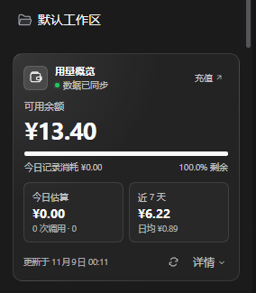
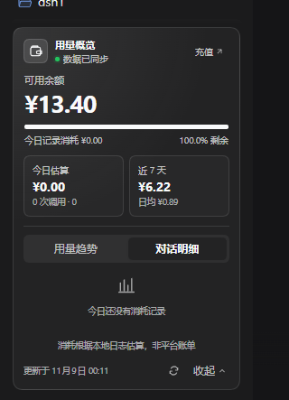
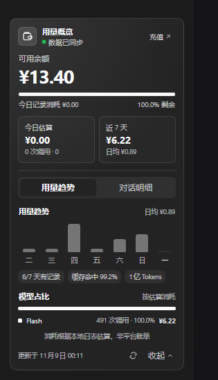

# dsh-balance-panel

A local-first, bottom-left balance and usage panel plugin for the [DeepSeek Harness](https://github.com/deepseek-ai/deepseek-harness) (DSH) workspace. It renders at the bottom of the left sidebar and shows the DeepSeek account balance, estimated spend from local session logs, a seven-day trend, and model share. The panel makes no model calls and consumes no model tokens.

一个运行在 DeepSeek Harness（DSH）工作区左下角侧栏底部的余额/用量面板插件：显示账户余额、今日估算消耗、近 7 天趋势、模型占比和逐对话明细。所有统计基于本地会话日志，不调用模型，不产生 Token 消耗。

## 截图







## 功能

- **余额与今日消耗**：读取 DeepSeek 账户余额，并显示今日累计消耗、调用次数、Token 总量。
- **近 7 天趋势**：按本地日期聚合七天数据，包含零用量日期；显示每日柱状图、日均、活跃天数、缓存命中率。
- **模型占比**：按估算金额聚合模型用量，显示 Top 4 和 “N more” 剩余项，包含调用次数、金额和占比。
- **逐对话明细**：展开后查看今日每个对话的标题、模型、调用次数、Token 和估算金额。
- **余额进度**：以“今日起始余额”为基准，显示剩余 / 已用比例；同时保留今日首次快照以来的实际差额。
- **窄栏适配**：侧栏收成 56 px 导轨时显示紧凑的 `¥` 按钮和状态点。
- **主题与可达性**：复用 DSH 主题变量，适配深浅色；提供焦点样式、`aria-*` 属性、`prefers-reduced-motion`。
- **异常降级**：断网时保留上次成功数据并显示提示；未登录时隐藏余额和充值入口，但本地用量仍可读。
- **本地优先**：宿主路由只接受 loopback 请求；不写会话、不调用模型、不采集遥测。

## 环境要求

| 项目 | 要求 |
|---|---|
| DSH | `0.2.2-rc.1` 实测通过（依赖 `sessionQuery`、`deepseekAccount`、`webServer`、`workspaceRegistry` 与 `sidebar.footer.action`） |
| Node.js | `>=20`（实测 `24.21.0`） |
| pnpm | `11.x`（仅打包 / 安装插件时需要；实测 `11.28.5`） |
| 浏览器 | DSH Web / Desktop 客户端使用的现代 Chromium（需要 `color-mix`、`Intl`） |
| React | 由 DSH Client 的模块表提供，插件不单独安装 React |

**npm 依赖**：运行时 **0 个 npm 依赖**，也没有 `peerDependencies`。

- 宿主 `index.js` 只使用 Node 内置模块：`node:fs`、`node:net`、`node:os`、`node:path`。
- 前端 `client.js` 只从 DSH 模块表 `require('react')`。
- DSH 服务（`sessionQuery`、`deepseekAccount`、`webServer`、`workspaceRegistry`）由宿主提供，不以 npm 包形式声明，避免版本预检把插件禁用。

## 安装

### 推荐：通过 DSH 的 `link:` 方式安装

`link:` 会把 profile 指向本仓库目录，而不是把源码复制进 `node_modules`。修改代码后只需重载插件，不需要重新安装。

1. 把仓库克隆到一个**稳定、不会被移动**的目录：

   ```bash
   git clone https://github.com/<your-account>/dsh-balance-panel.git
   cd dsh-balance-panel
   ```

2. 在 DSH 的插件管理器中安装这个目录。使用 `plugin_manager` 的 `install_bundle`，目标填**本仓库的绝对路径**：

   ```text
   plugin_manager install_bundle <absolute-path-to-repo>
   ```

   安装器会执行 pnpm，并在 profile 的 `package.json` 中生成类似：

   ```json
   {
     "dependencies": {
       "dsh-balance-panel": "link:<absolute-path-to-repo>"
     },
     "dsh": {
       "profile": {
         "bundles": ["@deepseek-ai/dsh-base", "@deepseek-ai/dsh-web-app", "dsh-balance-panel"]
       }
     }
   }
   ```

3. 重载插件：

   - 推荐：在插件管理器里先禁用 `dsh-balance-panel`，再启用；
   - 或者完全退出并重新启动 DSH。

   `link:` 安装下不需要再次执行 `pnpm install`。

> 不要把源码手动复制进 `node_modules`，也不要手改 profile 的 `package.json` 或 Junction；让插件管理器完成安装。

### 可选：命令行安装

如果 `dsh` 已在 `PATH` 中，也可以使用 CLI：

```bash
dsh plugin --profile <profile> add link:<absolute-path-to-repo>
```

`<profile>` 通常是 `desktop`。安装新 bundle 默认会自动启用；如果没有，请在插件管理器的 Plugins 页面手动启用。如果 CLI 不可用，使用上文的 `plugin_manager`。

### 可选：通过 tarball 安装

tarball 适合分发，但不适合持续改代码：

```text
plugin_manager install_bundle <path-to>/dsh-balance-panel-1.2.1.tgz
```

tarball 安装会把文件复制进 profile，后续修改必须重新安装。开发时优先使用 `link:`。

## 使用

- 打开 DSH 左侧栏底部，面板默认显示：余额、今日估算、近 7 天消耗与日均、同步状态。
- 点击 **详情 / Details** 展开：
  - **用量趋势**：7 天柱状图、活跃天数、缓存命中率、模型占比；
  - **对话明细**：今日逐对话用量。
- 点击刷新按钮立即拉取；前端每 45 秒轮询，页面隐藏时暂停，窗口重新可见或聚焦时刷新。
- 点击顶部充值入口会打开平台充值页（仅 `https:` 链接）。
- 侧栏收起成窄栏时，面板变成 `¥` 按钮；点击刷新。

面板的“今日消耗 / 近 7 天 / 模型占比”是**基于本地会话日志的估算**，不是平台账单；余额是账户服务的实时值。

## 配置

唯一配置是价格覆盖，写在 bundle 的 `cordis.patch.yml` 中：

```yaml
- id: balance-panel
  name: dsh-balance-panel
  config:
    prices:
      deepseek-flash:
        idle: { hit: 0.02, miss: 1, out: 4 }
        peak: { hit: 0.04, miss: 2, out: 8 }
```

- 单位：元 / 百万 Token；
- `hit` = 缓存命中，`miss` = 未命中输入，`out` = 输出（含 reasoning）；
- 未配置的模型回退到 `deepseek-flash`；
- 非法数值和不完整的新模型价目会被忽略。

默认价目表在 `index.js` 的 `OFFICIAL_PRICES`，高峰为北京时间工作日 `09:00–12:00`、`14:00–18:00`。

## HTTP API

插件只注册一个宿主机可读路由：

```text
GET /dsh-balance-panel/api/state
```

端口以当前 DSH Web GUI 地址为准，例如：

```bash
curl "http://127.0.0.1:<dsh-port>/dsh-balance-panel/api/state"
```

Windows PowerShell：

```powershell
Invoke-RestMethod "http://127.0.0.1:<dsh-port>/dsh-balance-panel/api/state"
```

核心响应：

```json
{
  "at": 1794082311017,
  "account": {
    "signedIn": true,
    "currency": "CNY",
    "balance": 15.041,
    "recharge": 15.041,
    "bonus": 0,
    "links": {
      "usageUrl": "https://platform.deepseek.com/usage",
      "topUpUrl": "https://platform.deepseek.com/top_up"
    },
    "error": null
  },
  "today": {
    "cost": 0.2474,
    "calls": 13,
    "sessions": 1,
    "tokens": {
      "input": 11183,
      "output": 40821,
      "cacheRead": 3887744,
      "cacheWrite": 2048,
      "reasoning": 1200,
      "total": 3943996
    },
    "complete": true,
    "delta": { "first": 15.2884, "at": 1794081524030, "spent": 0.2474 },
    "models": [],
    "conversations": []
  },
  "history": {
    "since": 1793894400000,
    "days": [],
    "total": { "cost": 0.8381, "calls": 53 },
    "averageCost": 0.1197,
    "activeDays": 5,
    "models": [],
    "complete": true
  },
  "conversations": [],
  "prices": {
    "source": "DeepSeek 官方价目表（元 / 百万 tokens，峰谷两档）",
    "models": ["deepseek-flash", "deepseek-v4-pro"],
    "estimated": true
  }
}
```

- `history.days` 始终包含最近 7 个本地日期，零用量日期也会出现。
- `today.models` / `history.models` 按估算金额降序。
- `complete: false` 表示会话读取失败、列表不可用，或候选数超过 40 个上限。

诊断入口：

- `GET ...?debug=1`：附带服务、缓存、环形日志和前端 boot graph；
- `GET ...?diagnose=1`：逐个执行 `readSession()` 与 `readSurface()` 校验，属于重操作，只在需要时调用。

两个诊断入口也只接受本机 loopback 请求。

## 隐私与安全

- **不调用模型**：宿主只读 `sessionQuery` / 本地日志，余额来自 `deepseekAccount` 的平台 HTTP 查询；插件不接触模型请求，也不会产生 Token 消耗。
- **不写会话**：插件不修改 Session、Agent 或工作区；`migrate.js` 仅在显式的 `import.json` 存在时执行一次性工作区恢复。
- **本地访问**：路由校验 `remoteAddress`、`Host` 和可选 `Origin`，只允许 loopback；`isLoopbackHostname` 使用 `node:net.isIP()` 严格校验，拒绝 `127.attacker.com` 之类的伪造主机名。
- **无密钥**：仓库不包含 API Key、Token 或凭据；余额读取使用 DSH 已登录的账户服务，插件不自行保存凭据。
- **无遥测**：没有 analytics、上报或远程日志。

> 注意：`Origin: null` 会被拒绝。当前 HTTP Web GUI 的同源 GET 不发送 `Origin`，因此正常；如果未来在 `file://` 渲染器中运行，需要另外设计 token / IPC 通道。

## 开发

```bash
# 单元测试（使用 Node 内置 test runner，无需安装依赖）
node --test index.test.js

# 或者
pnpm test
```

测试覆盖：计价、峰谷边界、本地日期、`readTitle` 新旧返回值、价格覆盖、路由重载清理、loopback 校验、会话聚合、跨窗口旧会话的 mtime 过滤。

打包：

```bash
pnpm pack
```

`index.test.js` 只用于开发，不包含在 npm 包中。

### 目录

```text
.
├── index.js                 # 宿主：路由、账户读取、7 天聚合、计价、缓存
├── client.js                # 前端：React 面板、趋势图、模型占比、交互
├── migrate.js               # 一次性历史工作区恢复（仅在 import.json 存在时运行）
├── index.test.js            # Node 单元测试
├── package.json             # Bundle / Client 清单
├── cordis.patch.yml         # Loader patch
├── locale/{zh,en}.json      # 插件管理器显示元信息
├── icon.svg                 # 插件图标
├── docs/screenshots/        # 面板截图
├── LICENSE                  # MIT
└── README.md
```

## 兼容性说明

- 针对 DSH `0.2.2-rc.1` 的 `sessionQuery` / `deepseekAccount` / `webServer` / `sidebar.footer.action` 实现编写。
- `readTitle()` 同时兼容字符串与旧版 `{ title }` 返回形状。
- 路由重载使用模块级 `WeakMap`，先释放旧路由再注册，并用身份检查保护清理。
- 7 天候选会话使用日志文件 mtime + `createdAt` 双信号，避免漏掉“创建较早但最近仍有写入”的会话。
- 如果 DSH 升级后上述服务或 slot 契约发生变化，请先运行 `?diagnose=1` 并查看 `?debug=1` 的 `clientModules` 行。

## License

MIT，见 [LICENSE](LICENSE)。
